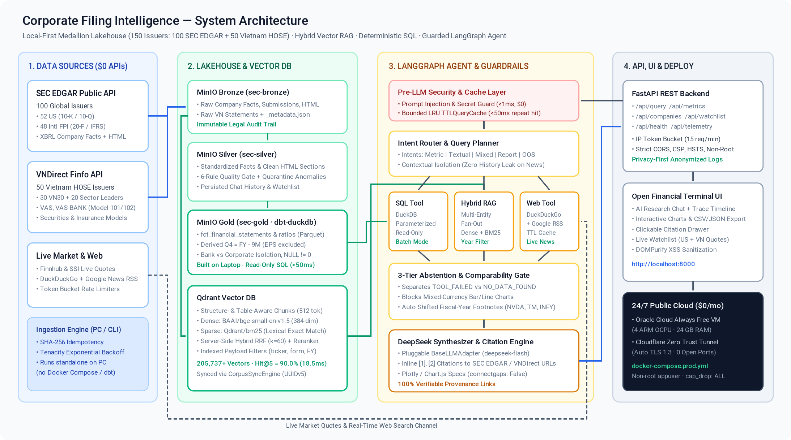
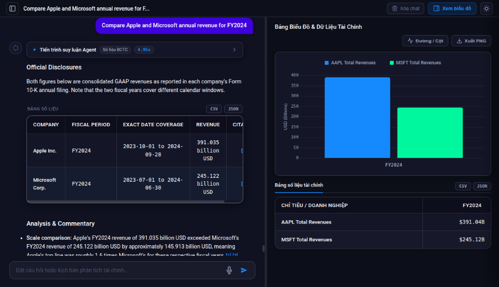
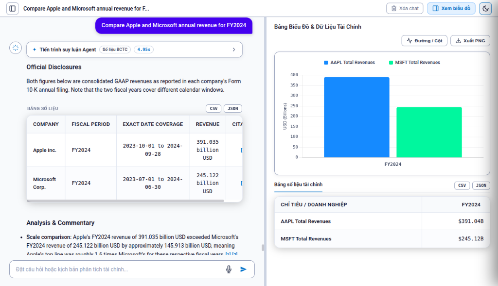

# Open Financial Terminal

An open-source, local-first AI financial research terminal built to analyze audited corporate filings across **150 public companies**, combining **100 international SEC filings** and **50 Vietnamese market leaders** with exact financial calculations, verifiable source citations, and built-in anti-hallucination safeguards.

- **Repository:** [https://github.com/hdminh279/open-financial-terminal](https://github.com/hdminh279/open-financial-terminal)
- **Website:** 

---

## Project Overview

### The Problem

Public financial disclosures run into thousands of pages across annual reports, quarterly filings, and Vietnamese financial statements. Analysts lose hours copying tables into spreadsheets and computing ratios by hand. Meanwhile, general-purpose AI chatbots frequently invent figures, mix currencies, confuse mismatched corporate fiscal calendars, or provide answers without verifiable links to official filings. Institutional research terminals solve parts of this workflow, but their high annual license fees keep them out of reach for individual investors, students, and small teams.

### Who This Is For

- **Equity and Research Analysts:** Compare multi-year performance, margins, growth trends, and business risks across global peers in seconds.
- **Individual Investors:** Ask questions in English or Vietnamese about financial statements, management commentary, and live stock watchlists with transparent evidence.
- **Corporate Finance and Strategy Teams:** Benchmark international companies reporting under different accounting standards while keeping comparability rules clear.
- **Finance Students and Researchers:** Explore real corporate disclosures backed by direct links to official regulatory filings.

### What It Solves

- **Exact Financial Numbers Without Guesswork:** Financial metrics, margins, and quarterly figures are retrieved from structured accounting tables rather than generated from memory by an AI model.
- **Grounded Narrative Research:** Strategic commentary, risk disclosures, and segment discussions are matched directly to official filing excerpts and paired with clickable source citations.
- **Live Market Awareness:** Real-time equity quotes and breaking web news sit alongside historical filings inside a unified research workspace.
- **Built-In Safety and Honesty:** The assistant preserves missing disclosures as blank rather than zero, blocks misleading mixed-currency charts, flags offset fiscal calendars, filters unsafe prompts before reaching the AI model, and declines to answer when evidence is absent.

---

## Architecture Overview



Data flows left to right from official US, international, and Vietnamese financial disclosures into structured storage, analytical and search engines, a multi-step AI research workflow with security filtering, and finally into the interactive Web Terminal.

---

## Web Terminal Preview

Explore audited filings, interactive comparison charts, exportable tables, source citations, and a live 100+ stock watchlist in both **Dark Mode** and **Light Mode**.

### Dark Mode



### Light Mode



---

## Verified Benchmarks

> Evaluated live across **850,868** indexed filing vectors, **150** tracked issuers (100 SEC + 50 VN30), DuckDB Gold marts, and DeepSeek API.

### Document Retrieval Quality and Speed

Evaluated across 20 grounded positive questions and 5 negative out-of-scope queries:

| Retrieval Strategy | Hit Rate @1 | Hit Rate @3 | Hit Rate @5 | Hit Rate @10 | Recall @5 | MRR | Median Latency |
| :--- | :---: | :---: | :---: | :---: | :---: | :---: | :---: |
| Semantic Search Only | 50.0% | 65.0% | 75.0% | 85.0% | 75.0% | 0.601 | 69.9 ms |
| Keyword Search Only | 60.0% | 70.0% | 75.0% | 85.0% | 75.0% | 0.658 | 10.6 ms |
| **Hybrid RRF Fusion (`k=60`)** | **60.0%** | **80.0%** | **85.0%** | **90.0%** | **85.0%** | **0.718** | **48.7 ms** |
| Hybrid Plus Neural Reranker | 55.0% | 75.0% | 90.0% | 90.0% | 90.0% | 0.666 | 5,673.9 ms |

### End-to-End Accuracy, Groundedness, and Reliability

| Evaluation Dimension | Measured Outcome | Scope |
| :--- | :---: | :--- |
| Overall Strict Pass Rate | **48 of 50 (96.0%)** | 50 real-data multi-market queries |
| Intent Classification Accuracy | **100.0%** | 50 real-data queries |
| Tool Selection Precision / Recall | **100.0% / 100.0%** | DuckDB SQL + Qdrant RAG |
| RAG Negative Abstention | **5 of 5 (100.0%)** — 0.0% false abstentions | Missing-disclosure and out-of-scope traps |
| Verifiable Citation Validity | **100.0%** — 288 of 288 links verified | Official filing and live web sources |
| Adversarial Security and Edge Suite | **90 of 90** clean responses — 0 leaks, 0 invented numbers | Ticker traps, currency traps, injection attacks at 4.83 s median latency |
| Automated Software and Data Checks | **306 of 306** unit tests · **26** data checks with **0** errors | Continuous verification across code, streaming, and accounting rules |

---

## Tech Stack

| Layer | Technologies |
| :--- | :--- |
| **Ingestion and Processing** | Python 3.11, `uv`, `httpx`, `tenacity`, BeautifulSoup4, `lxml`, `tiktoken`, PyArrow |
| **Lakehouse and Analytics** | MinIO S3-compatible Bronze/Silver/Gold storage, `dbt-duckdb`, DuckDB |
| **Vector Search and Embeddings** | Qdrant Hybrid Search with `BAAI/bge-small-en-v1.5` dense vectors and `Qdrant/bm25` sparse vectors |
| **AI Agent and Live Market Data** | LangGraph, DeepSeek API, DuckDuckGo Web Search, Finnhub Quotes, SSI Quotes |
| **Backend and Security** | FastAPI, Uvicorn, Pydantic v2, IP Token Bucket Rate Limiter, Pre-LLM Injection Guard, Security Headers |
| **Frontend and Deployment** | HTML5, CSS3, Vanilla JS, Chart.js, DOMPurify, Docker Compose, Cloudflare Tunnel, GitHub Actions CI |
| **Testing and Quality** | `pytest`, `ruff`, `node --check`, `dbt test` |

---

## Environment

### Prerequisites

- Python `3.11+` and [`uv`](https://docs.astral.sh/uv/)
- Docker and Docker Compose
- Node.js — optional, used by JavaScript syntax checks
- DeepSeek API key from [platform.deepseek.com](https://platform.deepseek.com/)
- Finnhub API key — optional, used for live US stock quotes in the Watchlist

### Configuration

Copy `.env.example` to `.env` before running:

```bash
cp .env.example .env
```

| Variable | Purpose | Example |
| :--- | :--- | :--- |
| `SEC_USER_AGENT` | Contact header required by SEC EDGAR fair-access rules | `CorporateFilingIntelligence user@example.com` |
| `DEEPSEEK_API_KEY` | API key for routing and grounded answer synthesis | Required for live AI queries |
| `LLM_MODEL` | DeepSeek model profile used by the agent | `deepseek-flash` |
| `FINNHUB_API_KEY` | Optional API key for live US stock prices in Watchlist | Optional |
| `APP_ENV` | Runtime mode selecting `local`, `docker`, or `prod` settings | `local` |
| `S3_ACCESS_KEY` / `S3_SECRET_KEY` | MinIO object storage credentials | Set your local or production credentials |
| `ALLOWED_ORIGINS` | Allowed browser origins in production mode | `https://your-domain.example.com` |

---

## How to Run

### 1. Install Dependencies

```bash
git clone https://github.com/hdminh279/open-financial-terminal.git
cd open-financial-terminal
make install
```

### 2. Batch Data Ingestion and Indexing on PC

If running heavy batch ingestion and embedding generation directly on a workstation with local MinIO on port `9000` and Qdrant on port `6333`:

```bash
make pc-pipeline
```

This runs three sequential stages:
- `make pc-ingest`: Fetches new SEC EDGAR and Vietnam HOSE filings while skipping objects already stored in Bronze.
- `make pc-process`: Parses Silver financial facts and force-rebuilds clean text chunks across all filings.
- `make pc-index`: Recreates the Qdrant hybrid index, generates dense and BM25 vectors, and verifies integrity.

Once finished, sync the `./data` folder back to your laptop or runtime host.

### 3. Build Analytical Marts and Start the Web Terminal

```bash
make up
make dbt
make check
```

Open the Web Terminal at `http://localhost:8000`.
Optional live 50-question evaluation:

```bash
make eval-50
```

---

## Troubleshooting

- **SEC EDGAR returns HTTP 403:** Verify `SEC_USER_AGENT` in `.env` follows SEC's `AppName contact@domain.com` format rather than a generic string.
- **Connection refused on port 9000 or 6333 when running CLI or dbt:** Confirm MinIO and Qdrant are running and `APP_ENV=local` is set in `.env` when running commands outside Docker containers.
- **Watchlist shows missing US prices:** Set `FINNHUB_API_KEY` in `.env` for live US stock prices; Vietnamese quotes from SSI and company names still work without a key.
- **Legacy SEC filings show empty spacer columns in RAG citations:** Run `make pc-process` followed by `make pc-index` to force-rechunk existing filings and recreate the Qdrant collection cleanly.
- **AI queries fail or time out:** Confirm `DEEPSEEK_API_KEY` is valid and outbound HTTPS traffic to `https://api.deepseek.com` is permitted.
